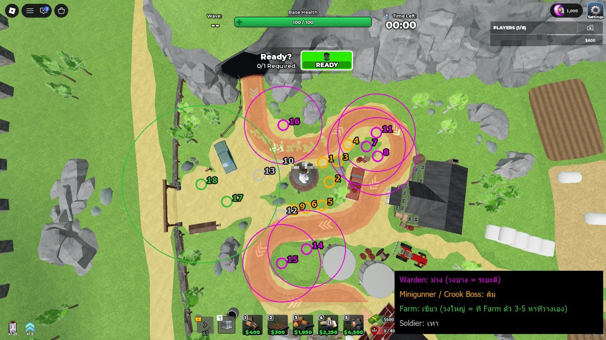

# TDS Bot

A free, local AI bot that plays **Roblox Tower Defense Simulator** by itself: it watches the screen, reads the
numbers, decides, and presses the keys and mouse like a player. Built for **Molten mode on Farm Lands, solo**,
and it can loop match after match unattended.



## What it does

- **Sees the game:** captures the Roblox window ~30 times a second. A small local vision model (`gemma3:4b`
  through [Ollama](https://ollama.com)) reads cash, wave and tower count.
- **Decides:** follows a build plan you can edit (place, upgrade, in order). A local decision model,
  [OneJev](https://github.com/OmniJev/OneJev), fills in the rest.
- **Places towers safely:** picks the tower up first, reads the game's red "can't place here" shading, then
  clicks the nearest clear point. The tower counter confirms each placement.
- **Uses abilities:** the Commander's Call to Arms (F) and Support Caravan (B), timed for bosses.
- **Follows the camera:** when a boss skill shakes or turns the view, clicks follow the map.
- **Plays the endgame:** at wave 34 it sells Farms and maxes Crook Bosses, the way a winning human player did.
- **Runs all night:**
  - clicks READY and Restart Match by itself;
  - logs every match to `matches.jsonl`;
  - keeps the PC awake.
- **Safe to stop:** press **Q** to pause and **ESC** to quit; moving the mouse to the top-left corner also quits.

**Results so far:** it reaches wave 35 (the Molten Warlord) and has beaten it on its own. By default it now
**gives wave 35 up on purpose**: a win sends the game back to the lobby, where the bot can't continue, while a
loss at 35 still pays coins and XP and offers Restart Match. Set `"final_wave": "win"` to play for the win.

## Requirements

- Windows 10/11, Roblox at 1920×1080
- Python 3.10+
- [Ollama](https://ollama.com), which downloads `gemma3:4b` (~3 GB) the first time
- An NVIDIA GPU: developed on an RTX 5070 (12 GB). The OneJev brain installs PyTorch with CUDA (several GB).
- In TDS, this tower loadout: **1 Soldier, 2 Farm, 3 Crook Boss, 4 Commander, 5 Warden**
- Recommended: turn **camera shake off** in the game's settings

## Quick start

1. Download or clone this repository.
2. Open Roblox and join Tower Defense Simulator.
3. Double-click **`Start TDS Bot.bat`**.

The first run installs everything (this takes a while). Then it asks you to click the tower spots on the map
once, and starts playing after a 3-second countdown.

| file | what it is for |
|---|---|
| `Start TDS Bot.bat` | start the bot (normal loadout) |
| `Start TDS Bot - Minigunner.bat` | start with a Minigunner loadout instead of Farm (`config_minigunner.json`) |
| `Edit Plan.bat` | edit the build plan in a small window |

## How it works

```
Roblox window ─▶ screen capture ─┬─▶ number reader (gemma3:4b): cash, wave, towers
                                 └─▶ brain: build plan + OneJev decision model
                                                   │
                                                   ▼
                          safety checks: cash, cooldowns, free spots, Roblox focused
                                                   │
                                                   ▼
                  keys and clicks (pydirectinput) ─▶ tower counter confirms
```

| file | job |
|---|---|
| `tds_bot.py` | main loop: capture, preview window, brain thread |
| `controls.py` | input, safety checks, placing and upgrading, camera tracking, restarts |
| `reader.py` | reads the numbers on screen with the vision model |
| `brain.py` | AI backends: OneJev, Ollama, any OpenAI-compatible API, or simple rules |
| `placement.py` | reads the red no-go shading to find a clear spot |
| `endgame.py` | waves 34-35: sell Farms, max Crook Bosses, track the boss along the path |
| `recorder.py` | records how *you* play a wave (to teach the bot) |
| `launch.py`, `calibrate.py`, `plan_editor.py` | one-click start, marking tower spots, the plan window |
| `config.json` | every setting: towers, build plan, keys, endgame |

Everything else, including each setting, troubleshooting, and notes on Molten mode, is in the
**[full guide](docs/GUIDE.md)**.

## Disclaimer

This is a personal hobby project. Automating gameplay may break Roblox's Terms of Use or the game's rules and
can get an account moderated. Use it at your own risk, ideally on an alt account in a private server. It is not
affiliated with Roblox or the makers of Tower Defense Simulator.

## License

[MIT](LICENSE)

---

### ภาษาไทย (สรุปสั้น ๆ)

บอทเล่น Tower Defense Simulator (Roblox) ให้เอง ฟรี และรันบนเครื่องตัวเองทั้งหมด ทำมาสำหรับโหมด Molten
แผนที่ Farm Lands เล่นคนเดียว เปิด `Start TDS Bot.bat` แล้วปล่อยไว้ได้ทั้งคืน บอทจะอ่านจอ เลือกจะวาง
หรืออัปป้อมอะไร แล้วกดปุ่มและคลิกเอง

- กด **Q** เพื่อหยุดชั่วคราว
- กด **ESC** เพื่อปิดบอท
- ผลแต่ละแมตช์อยู่ใน `matches.jsonl`

รายละเอียดทั้งหมดอยู่ใน [คู่มือ](docs/GUIDE.md)
